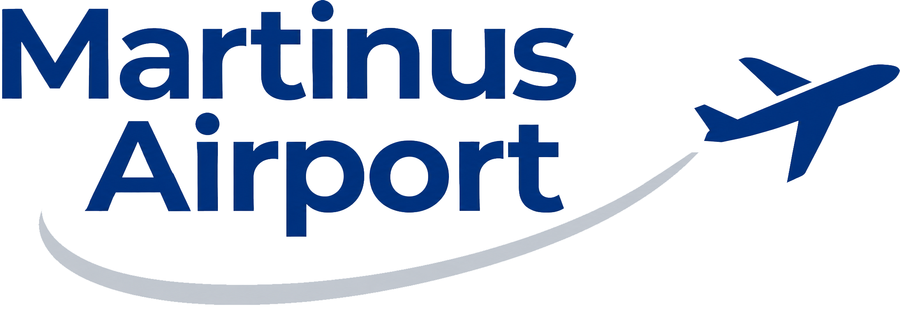
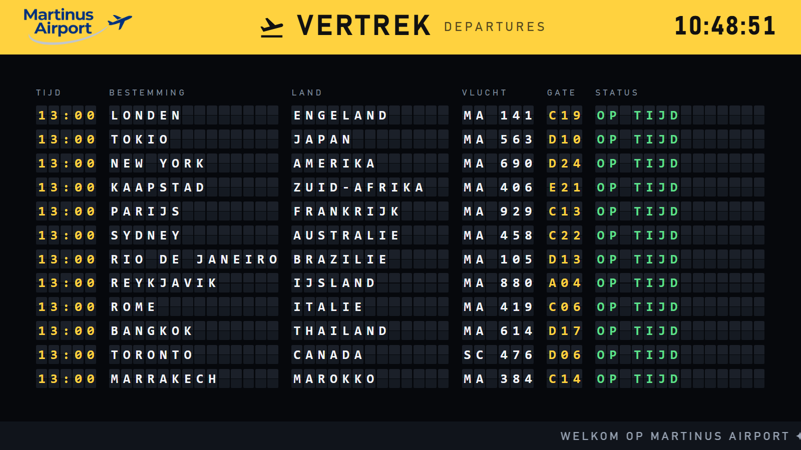
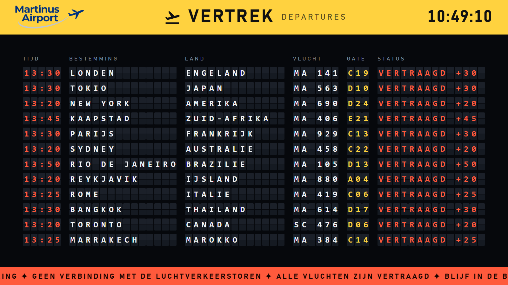
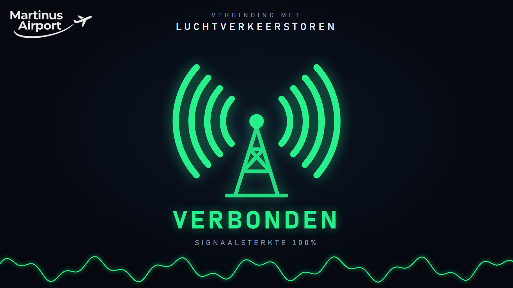
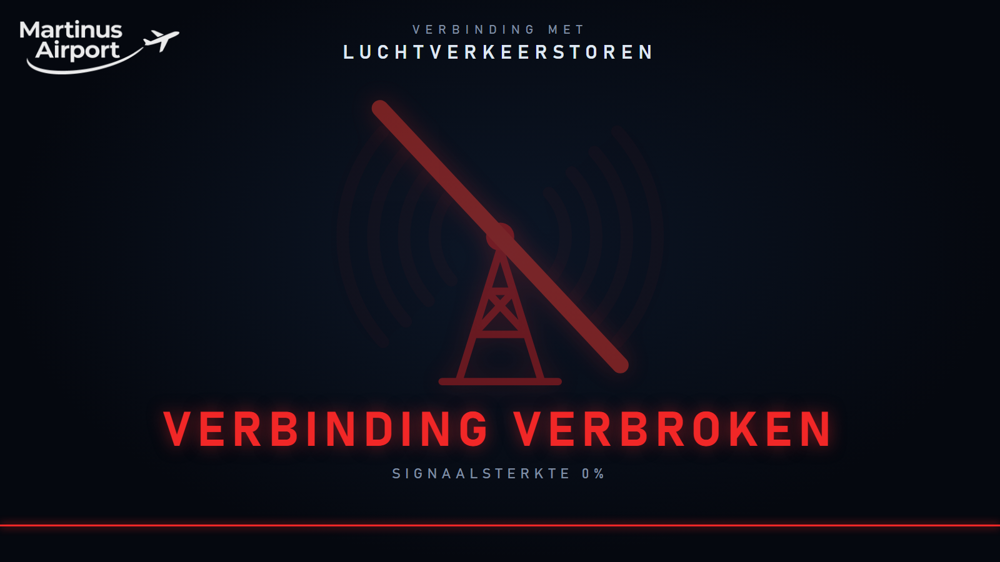
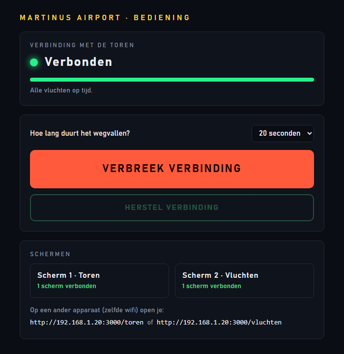

<p align="center">
  
</p>

# Martinus Airport

Twee beeldschermen en een bedieningspaneel voor het vliegveldspel. Met één druk op de knop valt de verbinding met de luchtverkeerstoren weg: het signaal zakt langzaam in, en zodra het helemaal weg is klappen alle vluchten op het vertrekbord één voor één om naar *vertraagd*. Is de opdracht gelukt, dan herstel je de verbinding en vertrekt alles weer op tijd.

| Alles in orde | Storing |
| --- | --- |
|  |  |
|  |  |

## Starten

Je hebt alleen [Node.js](https://nodejs.org) nodig, er hoeft niets geïnstalleerd te worden.

- **Windows:** dubbelklik op `start.bat`. Het bedieningspaneel opent vanzelf in de browser.
- **Overig:** `node server.js` en open daarna <http://localhost:3000>.

Een andere poort kies je met de omgevingsvariabele `PORT`. Stoppen doe je met `Ctrl+C`.

## De schermen

| Adres | Scherm | Waarvoor |
| --- | --- | --- |
| `/` | Bediening | Voor de spelleider: verbinding verbreken en herstellen |
| `/toren` | Scherm 1 · Toren | Zendmast met de signaalsterkte |
| `/vluchten` | Scherm 2 · Vluchten | Vertrekbord met alle vluchten |

De toren en het vertrekbord zet je op een eigen beeldscherm of beamer. Klik één keer op het scherm voor volledig beeld.

Staan de schermen op een ander apparaat? Zorg dat het op hetzelfde netwerk zit en open het adres dat bij het starten in het venster verschijnt en onderaan het bedieningspaneel staat, bijvoorbeeld `http://192.168.1.20:3000/toren`.

## Bedienen



1. Kies hoe lang het wegvallen duurt (5 seconden tot 2 minuten).
2. Druk op **Verbreek verbinding**. Op de toren verzwakt het signaal van groen via oranje naar rood.
3. Staat het signaal op 0%, dan raken de vluchten vertraagd. De vertraging loopt daarna elke 45 seconden met 5 minuten op.
4. Druk op **Herstel verbinding** om alles terug te zetten. De schermen laten nog anderhalve minuut zien dat de verbinding hersteld is.

Het paneel toont ook hoeveel schermen er meekijken, zodat je vooraf kunt zien of alles is aangesloten.

<br clear="right">

## Aanpassen

De vluchten staan bovenaan het script in [`public/vluchten.html`](public/vluchten.html), tussen `HIER AANPASSEN` en de streep eronder:

```js
const FIRST_DEPARTURE = '13:00'; // de vlucht die iedereen moet halen
const MINUTES_BETWEEN = 0;       // 0 = alles om 13:00, 5 = 13:00, 13:05, 13:10...
const DEST = [
  ['LONDEN', 'ENGELAND'], ['TOKIO', 'JAPAN'], ...
];
```

Maximaal 12 bestemmingen; een stad mag 14 letters lang zijn, een land 13. Vluchtnummers en gates worden automatisch bedacht en zijn op elk scherm gelijk. De lopende teksten onderin het bord (`TICKER_OK`, `TICKER_ALARM`, `TICKER_HERSTELD`) staan er direct onder.

## Hoe het werkt

`server.js` is een kleine Node-server zonder afhankelijkheden. Hij onthoudt alleen of de verbinding aan of uit staat en wanneer dat veranderde, en stuurt dat via server-sent events (`/events`) naar alle schermen. Elk scherm rekent de animatie zelf uit op de klok van de server, waardoor alle schermen precies gelijk lopen, ook als er een later wordt geopend of ververst.

```
server.js              server en toestand van de show
start.bat              starten op Windows
public/
  dashboard.html       bedieningspaneel
  toren.html           scherm 1
  vluchten.html        scherm 2
  common.js            verbinding met de server en gelijke klok
  img/                 logo
docs/                  schermafbeeldingen voor deze README
```

De toestand staat alleen in het geheugen: na opnieuw starten van de server is de verbinding weer gewoon aan.
